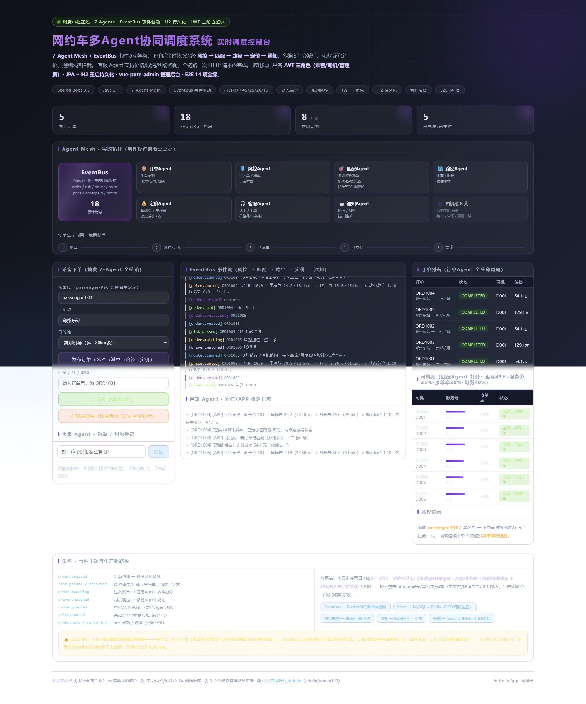
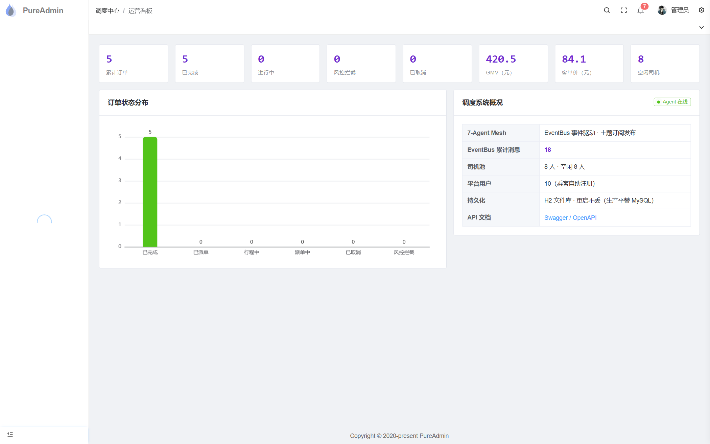

# 网约车多Agent协同调度系统（应用端）

**7-Agent Mesh + EventBus 事件驱动 + JWT 三角色鉴权 + 持久化落库 + 管理后台（vue-pure-admin）+ Swagger/OpenAPI**

> ⚠️ 口径纪律：架构、事件流、打分与计价公式、鉴权与持久化均为真实实现；高并发指标（如"支撑 XX 万单"）**未压测不写入简历**，压测方法见文末。

---

## 效果预览

| 实时调度大屏（/console，免登录） | 管理后台运营看板（/admin） |
|---|---|
|  |  |

## 一、三端入口

| 端 | 地址 | 账号 | 说明 |
|---|---|---|---|
| **管理后台** | http://127.0.0.1:8871/admin | `admin / admin123` | vue-pure-admin（Vue3+Vite+Element Plus+TS+Pinia）：运营看板/订单管理/司机管理/风控黑名单/Agent事件审计 |
| **演示控制台** | http://127.0.0.1:8871/console | 免登录 | 暗色科技风单页：7-Agent 拓扑实时点亮 + 下单/支付/客服全流程 |
| **Swagger 文档** | http://127.0.0.1:8871/swagger-ui.html | 免登录 | OpenAPI 全接口文档 |
| **H2 数据库控制台** | http://127.0.0.1:8871/h2-console | `ride / ride123` | JDBC URL: `jdbc:h2:file:./data/ride;MODE=MySQL` |

乘客端走管理后台同域 API（自助注册/登录/下单/我的订单）；司机端账号 `D001~D008 / 123456`（出发接驾/完成行程）。

## 二、运行

```bash
mvn package -DskipTests
java -jar target/ride-hailing-multiagent-1.0.0.jar --server.port=8871
# Windows 双击 start.bat（显式指定端口，防止环境中 SERVER__PORT 变量覆盖配置）
```

前端构建（管理后台源码在 `web-admin/`）：

```bash
cd web-admin && npm install --registry=https://registry.npmmirror.com
npm exec vite build     # 产物 dist/ → 拷贝至 src/main/resources/static/admin/
```

### E2E 验收（`e2e_test.py`，18 项断言全通过）

服务启动后运行 `python e2e_test.py`，覆盖：管理端页面加载 → `/` 重定向 → admin 登录 →
运营 KPI → 黑名单增/查/删 → 乘客注册/登录 → 下单（派单+计价明细）→ 支付 → 司机池 →
Agent 事件审计 → 未登录 401 → **调度大屏页面回归**（地理域必须是郑州）→
**演示口全链路**（下单→距离自洽→支付完结）。
其中 **地理自洽回归**（`geo-consistency`）：郑州东站→新郑机场订单 `distanceKm=32.5`
（直线 25.9km × 绕路系数），超出合理区间即说明坐标域被污染（防客户端传北京坐标复活）。
另有**重启持久化验证**：下单 ORD1001 → 重启服务 → 订单仍在且新单号续接
（本次会话两轮重启：ORD1001 → ORD1002/1003 → ORD1004/1005，H2 写穿持久化 + 序列恢复）。

### 视觉验收（`shot.py` + `verify_login.py`）

Playwright + Edge 无头截图：调度大屏（KPI 实测读值）+ 管理后台四页
（看板/订单/司机/黑名单）。`verify_login.py` 走**真实 UI 表单登录**
（admin/admin123 → 点登录 → 跳转看板），验证前端校验与字段映射链路。产物：`shot_*.png`。

## 三、应用架构

```
┌────────────────────────── 三端接入 ──────────────────────────┐
│  管理后台(vue-pure-admin)   演示控制台    Swagger    H2控制台   │
└───────────────┬─────────────────────────────────────────────┘
                │  JWT（HMAC-SHA256，PASSENGER/DRIVER/ADMIN 三角色拦截器）
┌───────────────▼─────────────────────────────────────────────┐
│  REST：/api/auth  /api/passenger  /api/driver  /api/admin     │
├──────────────────────────────────────────────────────────────┤
│  EventBus（Mesh 中枢，每条消息审计落库 agent_events）          │
│  订单Agent · 风控Agent · 匹配Agent · 路径Agent                │
│  定价Agent · 客服Agent · 通知Agent                            │
├──────────────────────────────────────────────────────────────┤
│  DemoStore：内存工作集 + 写穿持久化（JPA + H2 文件库）          │
│  users / orders / drivers / blacklist / agent_events 五张表    │
└──────────────────────────────────────────────────────────────┘
```

- **持久化**：订单每次状态迁移写穿入库，重启自动恢复（订单号序列续接、司机池/黑名单/账号首启种子）。生产平替 MySQL：仅改 `application.yml` 数据源。
- **鉴权**：`/api/admin/**` → ADMIN；`/api/driver/**` → DRIVER；`/api/passenger/**` → PASSENGER。令牌为 HMAC-SHA256 签名的 JWT 风格串，口令 SHA-256 加盐摘要（生产替换 BCrypt + Spring Security）。
- **生命周期**：CREATED → MATCHING → DISPATCHED → TRIP（司机出发接驾）→ PAID → COMPLETED；任意环节可 CANCELLED / RISK_REJECTED。司机端新增 `order.start.cmd` / `order.complete.cmd` 事件。

## 四、核心算法（面试必考口径）

### 1) 派单打分（DriverMatchingAgent）—— 4 维度加权
```
综合分 = 100 × (0.45×距离分 + 0.25×服务分 + 0.20×接单率分 + 0.10×接单量均衡分)
  距离分   = 1 - 司机距上车点/候选集中最远距离     （越近越高）
  服务分   = (rating - 4.0) / 1.0                （4.0~5.0 归一化）
  接单率分 = acceptRate                          （0.6~1.0）
  均衡分   = 1 - 今日接单量/候选集最大接单量       （防止头部司机垄断）
```
权重可配置；`DriverMatchingAgent.haversineKm()` 为球面距离（Haversine 公式）。

### 2) 动态溢价（PricingAgent）—— 供需比封顶模型
```
供需比 = 周边待匹配订单数 / 空闲司机数
溢价系数 = min(2.0, max(1.0, 1 + 供需比))      ← 封顶 2 倍，防舆情（行业惯例）
应付 = (起步价10元(含3km) + 2.4元/km×超程 + 0.6元/min×时长) × 溢价系数 - 满减券
```
### 3) 风控（RiskControlAgent）
黑名单拦截 → 10 分钟内同乘客 ≥3 单判刷单 → 异常订单识别；拦截发 `risk.rejected` 事件回流订单 Agent。黑名单管理端可增删并实时生效。

### 4) 取消规则
司机接单前取消免费；接单后取消收取应付 30% 空驶补偿。

## 五、API 一览（完整文档见 Swagger）

| 分组 | 方法 | 路径 | 说明 |
|---|---|---|---|
| 认证 | POST | `/api/auth/register` `/api/auth/login` | 乘客自助注册 / 登录（返回 token+角色） |
| 认证 | GET | `/api/auth/me` | 当前用户信息 |
| 乘客 | POST | `/api/passenger/orders` | 下单（触发 7-Agent 全链路） |
| 乘客 | GET | `/api/passenger/orders` | 我的订单（持久化历史） |
| 乘客 | POST | `/api/passenger/orders/{id}/pay` `/cancel` | 支付 / 取消 |
| 司机 | GET | `/api/driver/orders` | 待办订单（派给我的） |
| 司机 | POST | `/api/driver/orders/{id}/start` `/complete` | 出发接驾 / 完成行程 |
| 管理 | GET | `/api/admin/stats` | 运营看板（GMV/客单价/完成率/司机利用率） |
| 管理 | GET | `/api/admin/orders?status=&page=` | 订单分页管理 |
| 管理 | POST/DELETE | `/api/admin/blacklist` | 黑名单增删（实时生效） |
| 管理 | GET | `/api/admin/events?page=` | Agent 事件审计（全量落库） |
| 兼容 | POST | `/api/orders` `/api/orders/{id}/pay` `/cancel` `/api/service` | 演示控制台同款接口 |

## 六、目录结构

```
src/main/java/io/github/pke21515/ride/
├── core/            # Agent 接口 / EventBus（事件审计落库）/ Models / DemoStore（写穿持久化）
├── agents/          # 7 个 Agent（订单/风控/匹配/路径/定价/客服/通知）
├── entity/          # UserEntity / OrderEntity / DriverEntity / BlacklistEntity / EventEntity
├── repository/      # Spring Data JPA 五个仓库
├── security/        # TokenService（HMAC 令牌）+ AuthInterceptor（三角色拦截）
├── api/             # Auth / Passenger / Driver / Admin / Ride（兼容）控制器
└── config/          # WebConfig（拦截器/CORS/视图路由）+ AgentConfig
web-admin/           # vue-pure-admin 管理后台源码（Vue3+Vite+Element Plus+TS）
src/main/resources/static/admin/   # 管理后台构建产物
```

## 七、压测方法（要写并发数字前必做）

```bash
wrk -t4 -c200 -d30s --latency -s post.lua http://127.0.0.1:8871/api/orders
```
测出来的 P95/吞吐才能写进简历。

## 八、面试防守要点

1. **为什么用事件驱动不用直接方法调用**：Agent 间解耦，新增 Agent 零侵入；失败隔离在单 Agent 内。
2. **同步流怎么变成异步**：演示版同步便于确定性演示；生产用 MQ 后按主题消费，订单状态机不变。
3. **鉴权为什么手写 HMAC 不用 Spring Security**：最小依赖演示令牌机制本质（签名+载荷+过期），接口与 jjwt/OAuth2 对齐，可平滑替换。
4. **H2 为什么敢写上简历**：JPA 抽象层数据源无关，切 MySQL 只改配置——面试可现场演示。
5. **客户端不传经纬度怎么办**：`core/Geo.java` 兜底——地标表命中用真实坐标，未命中用地名哈希生成确定性伪坐标（同一地名结果稳定），Haversine 距离/计价/ETA 全链路数据自洽；司机种子池与地标同域（郑州）；ETA 有 120 分钟物理上限钳制。生产替换为高德地理编码 API，仅改本类。
6. **已知简化**：同步事件流、模拟路网、模拟通知——都能讲清替换路径。

## 九、作品集演示脚本（面试 90 秒）

1. 打开管理后台登录（`admin/admin123`）→ **运营看板**：KPI 卡 + 订单状态分布图实时刷新；
2. 「风控黑名单」页加入测试乘客 → 用该乘客在演示控制台下单 → **当场被拦截**；移出后恢复正常；
3. 演示控制台下单 → 事件流依次点亮 风控→匹配→路径→定价，价格框给出**完整计价公式**；
4. 管理后台「订单管理」看到新订单（持久化落库）→ **重启服务** → 订单还在（应用端 vs demo 的分水岭）；
5. 司机端账号登录（D001/123456）→ 出发接驾 → 完成行程 → 看板状态流转；
6. 「Agent事件审计」页展示全量 EventBus 消息（每条落库可回溯）；
7. 打开 Swagger 介绍接口分层（auth/passenger/driver/admin 四组 + 角色拦截）。

> 启动：双击 `start.bat` → http://127.0.0.1:8871
